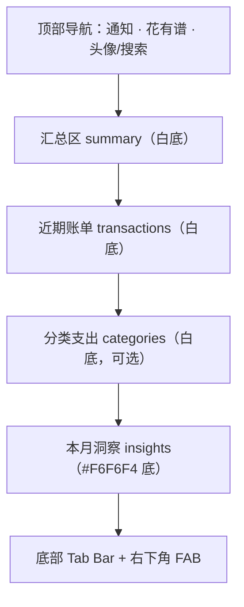
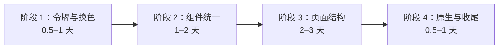

# 花有谱 UI 改版方案：参考 Mini Finance 设计稿

> 设计稿：[Mini Finance (Community)](https://www.figma.com/design/m8MYXljtl0GonKawBLWyJI/Mini-Finance--Community-)
> 读取范围：`🧱 Foundations`（颜色 / 字体 / 间距）、`Budget`、`Savings`、`Wallet` 三组页面
> 适用分支：`qingfeng`
> 文档日期：2026-11-05

---

## 1. 目标与原则

| 项 | 说明 |
| --- | --- |
| 目标 | 把当前偏“玻璃拟态 + 渐变图标 + 大圆角卡片”的 V21 风格，改为 Mini Finance 的**暖灰中性色 + 低饱和强调色 + 平铺分区（Section）**风格，更克制、更像专业理财工具 |
| 不变 | 业务逻辑、数据层、`LedgerNative` 桥接接口、页面 ID（`ledger / import / settings / manual / stats / assets`）、所有 `onclick` 入口、无障碍属性 |
| 只动 | CSS 设计令牌、少量 HTML 结构（区块分组 / 标题 / 胶囊按钮）、图标风格、原生弹窗 `MintDialog` 配色、桌面小部件配色 |
| 离线约束 | WebView 开启了 `blockNetworkLoads`，**字体和图标必须本地打包**，不能用 Google Fonts / CDN |

---

## 2. 设计稿关键规范（Design Tokens）

### 2.1 颜色

设计稿使用 6 组 16 阶色板（charcoal / verdant / sandstone / ember / ruby / marigold），再映射出语义令牌。下表只列改版需要用到的**语义令牌**：

#### 文本

| 令牌 | 色值 | 用途 |
| --- | --- | --- |
| `text/primary` | `#4D4845` | 标题、金额、正文 |
| `text/secondary` | `#65605C` | 次要说明 |
| `text/tertiary` | `#928F8B` | 时间、分类、辅助说明 |
| `text/disabled` | `#DBDBD8` | 禁用 / 占位 |
| `text/inverse` | `#FFFFFF` | 深色底上的文字 |
| `text/accent/verdant/primary` | `#215B44` | 收入金额（深） |
| `text/accent/verdant/secondary` | `#3D785F` | 收入标签 |
| `text/accent/ruby/secondary` | `#C9362B` | 支出金额 |
| `text/accent/sandstone/secondary` | `#976035` | 标签（橙棕） |

#### 表面 / 填充 / 边框

| 令牌 | 色值 | 用途 |
| --- | --- | --- |
| `surface/primary` | `#FFFFFF` | 页面主背景、普通区块 |
| `surface/secondary` | `#F6F6F4` | 强调区块背景（如 Insights）、胶囊按钮 |
| `surface/tertiary` | `#EFEFED` | 分隔、按下态 |
| `surface/overlay` | `rgba(0,0,0,.17)` | 底部弹层遮罩 |
| `border/primary` | `#F4F4F2` | 图标描边、列表分隔 |
| `border/secondary` | `#E7E7E4` | 输入框边框 |
| `icon/primary` | `#4D4845` | 主图标 |
| `icon/secondary` | `#A6A4A0` | 未选中 Tab 图标 |

#### 强调色（主色 + 浅底）

| 色系 | primary（填充） | secondary（浅底） | 建议用途 |
| --- | --- | --- | --- |
| verdant 绿 | `#4E886F`（fill）/ `#3D785F`（surface） | `#F3F7F5` | **品牌主色**：FAB、选中 Tab、收入、主按钮 |
| ruby 红 | `#F55D3E` | `#FFF4F1` | 支出、删除、错误 |
| ember 橙 | `#FD8240` | `#FFF4F0` | 预算进度、提醒、次要 CTA（设计稿中“Send”按钮） |
| sandstone 沙 | `#F0AB59` | `#FDF6E4` | 分类色、文章 / 提示卡 |
| marigold 金 | `#FAA800` | `#FFF5E3` | 待确认、警告 |

### 2.2 字体

| 设计稿样式 | 字号 / 行高 | 字重 | 本项目用途 |
| --- | --- | --- | --- |
| `large title/regular` | 32 / 48 | 400 | 月度总额、资产总额、记账输入金额 |
| `title/medium` | 24 / 36 | 500 | 弹层主标题 |
| `headline/regular` | 20 / 30 | 400 | 页面大标题（可选） |
| `body/medium` | 16 / 24 | 500 | 顶部导航标题（居中） |
| `subheadline/medium` | 14 / 20 | 500 | 区块标题、列表主文字、列表金额 |
| `footnote/regular` | 12 / 16 | 400 | 辅助说明、时间、分类 |
| `footnote/medium` | 12 / 16 | 500 | 胶囊按钮文字、图表数值 |
| `caption/regular` | 10 / 14 | 400 | 图表坐标轴 |

- 西文 / 数字字体：**Geist**（SIL OFL 1.1，可商用、可打包）；等宽数字可选 **Geist Mono**。
- 中文：Geist 没有中文字形，回退到系统字体。建议字体栈：
  `"Geist", "PingFang SC", "Noto Sans SC", "Microsoft YaHei", sans-serif`
- 整体特点：**字重偏轻（400/500），不用 700 粗体**，层级主要靠颜色深浅区分。现在的 `font-weight:800` 标题、`700` 金额都要降下来。

### 2.3 间距（sp 刻度）

| 令牌 | 值 | | 令牌 | 值 |
| --- | --- | --- | --- | --- |
| sp-3 | 4px | | sp-8 | 24px |
| sp-4 | 8px | | sp-9 | 32px |
| sp-5 | 12px | | sp-10 | 40px |
| sp-6 | 16px | | sp-11 | 48px |
| sp-7 | 20px | | sp-12 | 64px |

设计稿常用组合：

- 区块（Section）内边距 `24px 20px`，区块内元素间距 `20px`
- 区块标题组：标题 + 副标题，间距 `4px`
- 列表行：图标与文字间距 `12px`，行与行间距 `24px`（**不用分隔线**）
- 胶囊按钮：内边距 `8px 12px`，内部间距 `4px`

### 2.4 圆角与阴影

| 元素 | 圆角 |
| --- | --- |
| 胶囊按钮 / 月份选择 / “See all” | 24px（全圆） |
| 头像 / 列表图标 / FAB | 100px（正圆） |
| 弹层内的选项卡片 | 12px |
| 进度条 | 4px |
| 预览区 / 容器 | 8px |

- 页面内**基本不用阴影**，靠背景色（白 / `#F6F6F4`）区分区块。
- 只有浮层可以用 `elevation/el-5`：
  `0 8px 16px rgba(26,26,26,.08), 0 4px 6px rgba(26,26,26,.08), 0 1px 2px rgba(26,26,26,.12)`

### 2.5 尺寸

- 画板宽度 393（iPhone 15 Pro），左右安全边距 20px
- 顶部导航高 52，左侧通知图标、中间标题、右侧头像
- 底部 Tab Bar 高 60，白底，5 个纯图标（无文字），图标间距 32px
- FAB：verdant 主色正圆，内边距 20px，悬浮在 Tab Bar 右上方
- 列表图标 40×40，白底 + 1px `border/primary` 描边，正圆

---

## 3. 现状与差异

| 维度 | 现状（V21） | 设计稿（Mini Finance） | 改动 |
| --- | --- | --- | --- |
| 主色 | `--green:#279e80`（偏亮青绿） | verdant `#4E886F`（灰绿） | 替换 |
| 文字 | `--ink:#101421`（冷黑），`--muted:#818ba0`（冷灰） | `#4D4845` / `#928F8B`（暖灰） | 替换 |
| 页面背景 | `--page:#f4f6fa` + 半透明白卡片 `#ffffffbd` | 纯白页面，强调区块用 `#F6F6F4` | 去掉玻璃拟态 |
| 卡片 | 20px 圆角卡片 + 阴影 | 无卡片，通栏区块 | 结构调整 |
| 分类图标 | 49px 渐变圆（绿 / 蓝 / 橙 / 紫） | 40px 白底描边圆，图标为单色 | 替换 |
| 标题字重 | 800 / 700 | 400 / 500 | 降低 |
| 底部导航 | 圆角 30px 浮起导航，5 项带文字，中间凸起“+” | 直角白底，5 个纯图标；“+”改为右下角 FAB | 结构调整 |
| 列表 | 行高 85px，带分隔 | 行间距 24px，无分隔线 | 调整 |
| 月份选择 | 文字 + 下拉箭头 | 胶囊按钮 `February` + 圆形“调整”图标按钮 | 调整 |
| 汇总区 | 大号金额 + 迷你柱状图 | 32px 金额 + “Left / spent” + 横向进度条 | 调整 |

---

## 4. 页面映射方案

### 4.1 首页 / 账本（`#ledger`）← Budget / main



| 区块 | 设计稿元素 | 本项目内容 |
| --- | --- | --- |
| 顶部导航 | `top nav`：通知图标 / 居中标题 `body/medium` / 头像 | 左：搜索图标；中：“账本”；右：识别入口（摇一摇 / 导入图标） |
| 汇总区 | `summary`：月份胶囊 + 调整按钮；`$2,215.90`（32px）+ `Left`；进度条 + `$1,285 / $3,500 spent` | 月份胶囊（替代当前 `#month`）+ 支出/收入切换胶囊（替代 `.filter`）；本月支出金额 32px；如有预算显示进度条，否则显示“较上月 ±x%” |
| 近期账单 | `transactions`：标题“Recent Transactions”+“23 total”；行：40px 图标、名称 + 分类、金额（支出红 / 收入绿）+ 时间；底部“See all”胶囊 | 按日期分组保留，但日期头改为 `footnote/regular` 灰色小字；金额颜色：支出 `#C9362B`，收入 `#3D785F`；“待确认”标签改用 marigold 浅底 |
| 识别记录 | — | 复用列表行样式，图标位放 spinner，右侧状态文字用 `text/tertiary` |

### 4.2 统计（`#stats`）← Budget / main 中的 cash flow + categories + insights

| 设计稿 | 本项目 |
| --- | --- |
| `cash flow` 收支柱状对比 + 图例 | 收支趋势图：柱子用 verdant / ruby，坐标轴 `caption/regular` |
| `categories`：每行“正圆图标 + 名称 + 4px 进度条 + `$367 / $700`” | **替换当前甜甜圈图 + 图例**：分类排行改为进度条列表，颜色按 verdant → ember → sandstone → ruby → marigold 循环 |
| `insights`：`#F6F6F4` 底，7 根柱 + 均值线 + “Learn more” | 近 7 天 / 近 6 月支出柱状图 + 平均值标注 |

> 如果想保留甜甜圈图，至少把配色换成设计稿强调色，中心文字改为 `large title/regular`。

### 4.3 手动记账（`#manual` / `#manual-panel`）← Wallet / send money

设计稿的“Send Money”页是**整屏深绿背景 + 白色大金额 + 白色数字键盘**，很适合做记账输入：

| 设计稿 | 本项目 |
| --- | --- |
| 背景 `palette/verdant/11` `#3D785F`（带细纹理） | 支出时用 verdant 深绿，收入时可切成 sandstone `#D99650` 或保持绿色 |
| “How much?” `text/disabled` + `$280.00` 32px 白字 | “记一笔” + `¥ 0.00` 大字 |
| `recipient`：80px 头像 + 名称 | 换成**当前选中分类**：80px 正圆图标 + 分类名，点击展开分类网格 |
| 键盘：3×4，数字 24px 白字，无按键边框 | 替换现有 `.entry-keyboard`：去掉按键底色和边框，只保留文字 |
| “Send” 胶囊按钮 ember `#FD8240` | “保存” 胶囊按钮（ember 或白底绿字） |

> 分类网格（`#category-grid`）改到底部弹层，选项改成“40px 描边圆图标 + 文字”。

### 4.4 账单详情 / 截图导入（`#import`、`#record-panel`）← Budget / transaction details + create new

- 详情弹层：白底，顶部居中 `body/medium` 标题，左右 20px 内边距。
- 字段行（商户 / 金额 / 分类 / 时间 / 备注）：左侧 `footnote/regular` 灰色标签，右侧 `subheadline/medium` 值，行间距 24px，不画边框。
- 金额：`large title/regular` 32px，支出 / 收入用对应强调色。
- 截图预览：8px 圆角，`#F6F6F4` 底。
- “新建”入口：参考 `create new` 底部弹层，用 3 张 96px 高、12px 圆角的**彩色卡片**：
  - verdant：手动记账
  - sandstone：截图导入
  - ruby：摇一摇 / 自动识别设置

### 4.5 资产（`#assets`）← Wallet / main

| 设计稿 | 本项目 |
| --- | --- |
| `summary`：“Wallet Balance” `text/tertiary` + `$6,192.50` 32px；“Fund / Send”胶囊 | “总资产” + 金额；“添加账户 / 隐藏金额”胶囊 |
| `quick send`：横向头像列表 | 账户快捷入口：银行图标横排（复用 `web/banks/*.png`，套 40px 圆形描边容器） |
| `transactions` 列表 | 账户列表：图标 + 名称 + 类型 + 余额 |

### 4.6 我的 / 设置（`#settings`）← Savings / goals settings

- 设置分组改为通栏区块：分组标题 `subheadline/medium`，下面是设置行。
- 设置行：左侧 40px 描边圆图标，中间标题 + `footnote/regular` 说明，右侧开关 / 箭头。
- 开关：开启时 verdant `#4E886F`，关闭时 `#E7E7E4`。
- 运行状态提示（“识别服务运行中”等）用 verdant 浅底 `#F3F7F5` + 深绿文字的胶囊。
- 涉及文件：`settings-v30.css`、`permission.css`（权限引导弹层同样换色）。

### 4.7 底部导航

- 当前：5 项（首页 / 统计 / ＋ / 资产 / 我的），带文字，中间凸起圆按钮。
- 方案 A（**推荐，贴近设计稿**）：4 个纯图标 Tab（首页 / 统计 / 资产 / 我的），高 60px 白底，顶部 1px `border/primary`；“＋”独立成右下角 FAB（verdant 正圆，56px）。
- 方案 B（保守）：保留 5 项结构，只换配色、去掉文字和凸起效果。
- 选中态：图标 `icon/primary` `#4D4845`；未选中 `icon/secondary` `#A6A4A0`。

> ⚠️ `index.html` 中底部导航重复写了 4 份（约第 116、344、556、637 行），改结构时要 4 处同步；更好的做法是抽成一个导航节点，由 `go()` 控制选中态。

### 4.8 弹层与提示

| 元素 | 方案 |
| --- | --- |
| `#sheet` 底部弹层 | 白底，顶部圆角 24px，遮罩 `rgba(0,0,0,.17)`，标题居中 `body/medium` |
| 主按钮 | verdant 底白字胶囊，高 44px |
| 次按钮 | `#F6F6F4` 底 `#4D4845` 字胶囊 |
| Toast | `#4D4845` 底白字，24px 圆角 |
| 删除撤销条 | 同 Toast，“撤销”用 ember 文字 |

### 4.9 原生部分

| 位置 | 改动 |
| --- | --- |
| `res/values/styles.xml` | `colorAccent` → `#4E886F`；`statusBarColor` / `navigationBarColor` / `windowBackground` → `#FFFFFF` |
| `MainActivity.kt` | WebView 和外层 `FrameLayout` 背景色 `rgb(248,250,252)` → `#FFFFFF` |
| `MintDialog`（原生弹窗） | `INK` 等常量换成 `#4D4845` / `#928F8B`，主按钮 `#4E886F` |
| 桌面小部件 `widget_today_ledger.xml` | 卡片底 `#FFFFFF`、描边 `#F4F4F2`；支出 `#C9362B`、收入 `#3D785F`；按钮 `bg_widget_button.xml` → `#4E886F` 24dp 胶囊；文字主色 `#4D4845` |

---

## 5. 技术实施方案

### 5.1 新增设计令牌文件

新建 `app/src/main/assets/web/tokens.css`，在 `index.html` 中**放在 `v21.css` 之前**引入：

```css
@font-face{font-family:"Geist";src:url("vendor/webfonts/Geist-Regular.woff2") format("woff2");font-weight:400;font-display:swap}
@font-face{font-family:"Geist";src:url("vendor/webfonts/Geist-Medium.woff2") format("woff2");font-weight:500;font-display:swap}

:root{
  /* text */
  --mf-text-1:#4D4845; --mf-text-2:#65605C; --mf-text-3:#928F8B; --mf-text-disabled:#DBDBD8; --mf-text-inverse:#FFFFFF;
  /* surface */
  --mf-surface-1:#FFFFFF; --mf-surface-2:#F6F6F4; --mf-surface-3:#EFEFED; --mf-overlay:rgba(0,0,0,.17);
  --mf-border-1:#F4F4F2; --mf-border-2:#E7E7E4;
  --mf-icon-1:#4D4845; --mf-icon-2:#A6A4A0;
  /* accents */
  --mf-verdant:#4E886F; --mf-verdant-strong:#3D785F; --mf-verdant-text:#215B44; --mf-verdant-bg:#F3F7F5;
  --mf-ruby:#F55D3E;    --mf-ruby-text:#C9362B;      --mf-ruby-bg:#FFF4F1;
  --mf-ember:#FD8240;   --mf-ember-bg:#FFF4F0;
  --mf-sand:#F0AB59;    --mf-sand-text:#976035;      --mf-sand-bg:#FDF6E4;
  --mf-gold:#FAA800;    --mf-gold-bg:#FFF5E3;
  /* spacing */
  --sp-1:4px; --sp-2:8px; --sp-3:12px; --sp-4:16px; --sp-5:20px; --sp-6:24px; --sp-8:32px; --sp-10:40px;
  /* radius */
  --r-bar:4px; --r-box:8px; --r-card:12px; --r-pill:24px; --r-round:100px;
  /* type */
  --font:"Geist","PingFang SC","Noto Sans SC","Microsoft YaHei",sans-serif;
  --shadow-float:0 8px 16px rgba(26,26,26,.08),0 4px 6px rgba(26,26,26,.08),0 1px 2px rgba(26,26,26,.12);

  /* 兼容旧变量：先让现有样式整体换色 */
  --green:var(--mf-verdant); --ink:var(--mf-text-1); --muted:var(--mf-text-3);
  --page:var(--mf-surface-1); --surface:var(--mf-surface-1); --line:var(--mf-border-1);
}

/* 字体层级工具类 */
.t-large-title{font:400 32px/48px var(--font)}
.t-title{font:500 24px/36px var(--font)}
.t-body-m{font:500 16px/24px var(--font)}
.t-sub-m{font:500 14px/20px var(--font)}
.t-foot{font:400 12px/16px var(--font)}
.t-foot-m{font:500 12px/16px var(--font)}
.t-caption{font:400 10px/14px var(--font)}

/* 通用组件 */
.mf-section{background:var(--mf-surface-1);padding:var(--sp-6) var(--sp-5);display:flex;flex-direction:column;gap:var(--sp-5)}
.mf-section.alt{background:var(--mf-surface-2)}
.mf-pill{display:inline-flex;align-items:center;gap:var(--sp-1);padding:8px 12px;border-radius:var(--r-pill);background:var(--mf-surface-2);color:var(--mf-text-1);font:500 12px/16px var(--font)}
.mf-icon-40{width:40px;height:40px;flex:0 0 40px;border-radius:var(--r-round);background:#fff;border:1px solid var(--mf-border-1);display:flex;align-items:center;justify-content:center;color:var(--mf-icon-1)}
.mf-progress{position:relative;height:4px;border-radius:var(--r-bar);background:color-mix(in srgb,currentColor 40%,transparent)}
.mf-progress>i{position:absolute;inset:0 auto 0 0;border-radius:var(--r-bar);background:currentColor}
.mf-fab{position:fixed;right:20px;bottom:76px;width:56px;height:56px;border-radius:var(--r-round);background:var(--mf-verdant);color:#fff;box-shadow:var(--shadow-float)}
```

> `color-mix()` 需要 Chromium 111+。项目 `minSdk=30`，Android 11 的 WebView 可能较旧（`app.js` 里已经有 flex gap 兼容探测），进度条底色建议改为直接写 `opacity:.4` 的伪元素，与设计稿 `opacity=0.4` 一致。

### 5.2 字体打包

1. 从 [vercel/geist-font](https://github.com/vercel/geist-font) 下载 `Geist-Regular.woff2`、`Geist-Medium.woff2`（如需等宽数字，再加 `GeistMono-Regular.woff2`）。
2. 放到 `app/src/main/assets/web/vendor/webfonts/`。
3. `MainActivity` 的 `shouldInterceptRequest` 已支持 `.woff2 → font/woff2`，**不用改原生代码**。
4. 把 Geist 的 OFL 许可证加到 `assets/licenses/`，并在 `inventory.json` 登记（项目有许可证清单校验，见 `NOTICE.md`）。
5. 体积：每个字重约 30–40KB，可以接受。

### 5.3 图标

- 设计稿用的是**线性、细描边**图标（“base icons”），当前项目用 Font Awesome **Solid**。
- 方案：优先换成 Font Awesome **Regular**（已打包 `fa-regular-400.woff2`，零新增依赖）；Regular 缺的图标继续用 Solid，但缩小到 18px，颜色用 `icon/primary`。
- 分类图标去掉 `categoryStyle()` 返回的渐变色类（`blue / orange / pink / green`），改为统一 `.mf-icon-40`。如需区分，只给图标本身着色，颜色对应关系：
  - 餐饮 / 日用 → verdant
  - 交通 / 出行 → ember
  - 购物 / 服饰 → sandstone
  - 娱乐 / 人情 → ruby
  - 居住 / 医疗 / 其他 → `icon/primary`
  - 收入类 → verdant

### 5.4 需要修改的文件

| 文件 | 改动 | 规模 |
| --- | --- | --- |
| `web/tokens.css`（新增） | 设计令牌、字体、通用组件 | 新增约 120 行 |
| `web/index.html` | 引入 `tokens.css`；首页 / 统计 / 资产按 Section 重组；底部导航改结构（4 处）；新增 FAB | 中 |
| `web/v21.css` | 去掉玻璃拟态（`backdrop-filter`、半透明白）、卡片阴影、渐变 | 中 |
| `web/app.css` | 字重、字号、颜色替换为令牌；列表行、汇总区、键盘、分类网格重写 | 大 |
| `web/settings-v30.css` | 设置行、开关、状态胶囊 | 中 |
| `web/permission.css` | 权限引导弹层换色 | 小 |
| `web/app.js` | `categoryStyle()` / `ledgerIcon()` 输出新类名；统计页分类排行改为进度条列表（`drawStats`）；`chartColors` 换成设计稿强调色 | 中 |
| `res/values/styles.xml`、`brand.xml` | 系统栏颜色、强调色 | 小 |
| `ui/MainActivity.kt` | 背景色常量 | 小 |
| `ui/MintDialog.kt` | 原生弹窗配色 | 小 |
| `res/layout/widget_today_ledger.xml`、`res/drawable/bg_widget_*.xml` | 小部件配色 | 小 |
| `assets/licenses/*` | Geist 字体许可证 | 小 |

---

## 6. 分阶段实施



### 阶段 1：令牌与整体换色（风险最低，效果最明显）
- 新增 `tokens.css`，引入 Geist 字体。
- 通过兼容变量（`--green / --ink / --muted / --page`）把现有样式整体换成暖灰 + verdant。
- 全局降低字重：800 → 500，700 → 500 / 400。
- 去掉 `--surface:#ffffffbd` 半透明卡片与 `backdrop-filter`。
- **验收**：所有页面都能正常打开，颜色和字体已经是设计稿风格，布局不变。

### 阶段 2：组件与导航换色
- **底部导航**：按确认的方案 B 改造，保持 5 项结构，去掉 30px 大圆角与半透明模糊，改为白底 + 顶部 1px 描边；未选中图标 `#A6A4A0`，选中 `#4D4845`；中间“＋”按钮改为 verdant `#4E886F` 正圆。
- **列表行**：分类图标改为 40px 白底描边圆，单色强调色；金额颜色调整（支出 `#C9362B`、收入 `#3D785F`）；行与行保持间距，去掉多余分割线。
- **胶囊按钮**：月份选择、分类筛选、操作按钮统一为 24px 圆角胶囊样式。
- **弹层与提示**：`#sheet`、`#record-panel`、Toast 与撤销条统一采用暖灰风格。

### 阶段 3：页面细化与键盘样式
- **首页**：汇总区按设计稿简化为轻量卡片/区块，展示当月总额与收支切换；近期账单区块化。
- **统计页**：保留甜甜圈图，更新配色顺序为 verdant → ember → sandstone → ruby → marigold；中心文字改为 32px / 400；排行榜保持结构并适配新行高与字号。
- **手动记账**：保持白底卡片风格，仅将数字键盘升级为设计稿 Send Money 风格（无按键边框、24px 纯文字、轻柔按下态）。
- **资产页**：顶部总资产样式重塑，银行账户列表适配 40px 描边圆形图标。

### 阶段 4：预算功能闭环（独立模块）
- **数据层**：`LedgerStore` 升级版本并创建 `budgets` 预算表；实现增删改查与月度总预算/分类预算计算。
- **桥接层**：在 `LedgerWebBridge` 增加预算读写接口，在 `summary` 中返回预算执行情况。
- **UI 联动**：首页汇总区接入“剩余预算 / 预算进度条 / 超支提醒”；提供设置总预算与分类预算的底部交互面板；备份恢复模块适配。

### 阶段 5：原生与端到端收尾
- `styles.xml`、`MainActivity` 背景、`MintDialog` 原生弹窗、桌面小部件配色与字体同步。
- 大字体模式（`.large-text`）、横屏、窄屏兼容性全面测试。
- 编译与打包验证，确保全离线无网络请求且 Release 混淆正常。

---

## 7. 验证清单

- [ ] 6 个页面 + 记账弹层 + 账单详情 + 设置引导 + CSV 预览弹窗 全部截图对比
- [ ] 支出 / 收入 / 待确认 / 退款 / 识别中 五种列表行状态
- [ ] 空状态（无账单、无账户）
- [ ] 系统字体缩放 1.0 / 1.3 / 1.5
- [ ] 360dp 窄屏、横屏
- [ ] Android 11 旧 WebView（无 flex gap）兼容
- [ ] Release 构建（JS 混淆后）功能正常：`./gradlew -PledgerAbi=arm64-v8a -PledgerPython=python3 :app:assembleRelease`
- [ ] 无网络请求（字体、图标全部来自 `appassets.androidplatform.net`）
- [ ] 许可证清单包含 Geist（OFL-1.1）

---

## 8. 已确认决策（2026-11-05）

| # | 问题 | 决策 | 对方案的影响 |
| --- | --- | --- | --- |
| 1 | 底部导航 | **保留现有 5 项（首页 / 统计 / ＋ / 资产 / 我的），只换颜色** | 采用 4.7 的**方案 B**；不新增 FAB；导航结构和 4 份重复的 HTML 不用改，只改 CSS |
| 2 | 品牌主色 | **完全换成设计稿灰绿 verdant `#4E886F`** | `brand.xml` 的珊瑚色 `#EE7756` 不再作为 UI 强调色（应用图标保持不变）；中间“＋”按钮、选中态、主按钮、开关统一用 verdant |
| 3 | 统计页图表 | **保留甜甜圈图** | 4.2 中“分类排行改为进度条列表”取消；甜甜圈图和图例只换配色与字体，`chartColors` 换成设计稿强调色 |
| 4 | 手动记账 | **保持白底，只换键盘样式** | 4.3 中“整屏深绿背景”取消；保留现有白底布局，只把数字键盘改成设计稿风格（见下） |
| 5 | 预算功能 | **要做** | 首页汇总区按设计稿实现“剩余金额 + 进度条 + 已花 / 预算”；需新增预算数据与设置入口（见 8.1） |

### 决策后的具体调整

**底部导航（方案 B）**
- 背景改为 `#FFFFFF`，去掉 30px 大圆角和浮起阴影，顶部加 1px `border/primary` `#F4F4F2`。
- 图标 + 文字保留；选中态图标和文字 `#4D4845`，未选中 `#A6A4A0`。
- 中间“＋”按钮：verdant `#4E886F` 正圆，白色图标，去掉凸起偏移，阴影改为 `elevation/el-5` 或去掉。

**统计页（保留甜甜圈）**
- 甜甜圈配色顺序：`#4E886F`（verdant）、`#FD8240`（ember）、`#F0AB59`（sandstone）、`#F55D3E`（ruby）、`#FAA800`（marigold）、`#A6A4A0`（其他）。
- 中心金额用 `large title/regular`（32px / 400），说明文字 `footnote/regular` `#928F8B`。
- 图例与排行列表沿用现有结构，只换颜色、字号和行间距；收支趋势和洞察区按 4.2 的配色执行。

**手动记账（白底 + 新键盘）**
- 页面背景、金额区、分类网格保持白底，只做 2.x 规范内的配色 / 字体替换。
- 键盘按设计稿 Send Money 的键盘改：3×4 网格，**去掉按键底色和边框**，数字 24px / 400，颜色 `#4D4845`；按下态用 `#F6F6F4` 圆形背景。
- “保存”按钮：verdant 胶囊，白字。

### 8.1 预算功能需求（新增）

设计稿依据：Budget / main 的 `summary`（`$2,215.90 Left`、进度条、`$1,285 / $3,500 spent`）和 `categories`（每个分类的进度条 + `$367 / $700`）。

| 层级 | 内容 |
| --- | --- |
| 数据 | `LedgerStore` 新增 `budgets` 表：`month TEXT`（`yyyy-MM`，或 `*` 表示每月默认）、`category TEXT`（空字符串表示总预算）、`amount INTEGER`（分）、`updated_at`；数据库版本 8 → 9，写迁移 |
| 计算 | 本月已花 = 现有 `LedgerReadView.summary()` 中的支出合计；剩余 = 预算 − 已花（可为负，显示“超支”）；分类预算按 `category` 汇总 |
| 桥接 | `LedgerWebBridge` 新增 `budget(month)`（读取）、`saveBudget(json)`、`deleteBudget(month, category)`；`summary()` 返回中附带 `budget` 字段，前端少一次调用 |
| 首页 UI | 汇总区：月份胶囊 + 调整按钮（打开预算设置）；金额显示“剩余 ¥x”（32px）；4px 进度条（ember 填充 + 40% 透明底，超支时改 ruby）；下方 `¥已花 / ¥预算` |
| 设置 UI | 底部弹层：总预算输入（复用新键盘样式）+ 分类预算列表（分类 + 金额，可增删）；“沿用到以后每月”开关 |
| 统计页 | 分类排行行内可选显示该分类的预算进度（`¥367 / ¥700`）；无预算的分类不显示 |
| 未设预算 | 首页汇总区回退为“本月支出 + 较上月变化”，并显示“设置预算”胶囊入口 |
| 备份 / 导出 | `LedgerBackup` 备份与恢复需包含 `budgets` 表；CSV 导出不受影响 |
| 小部件（可选） | 今日收支小部件可增加一行“本月剩余预算” |

> 预算功能涉及数据库迁移和备份格式，建议放在 UI 改版第 3 阶段之后单独开发、单独测试。
